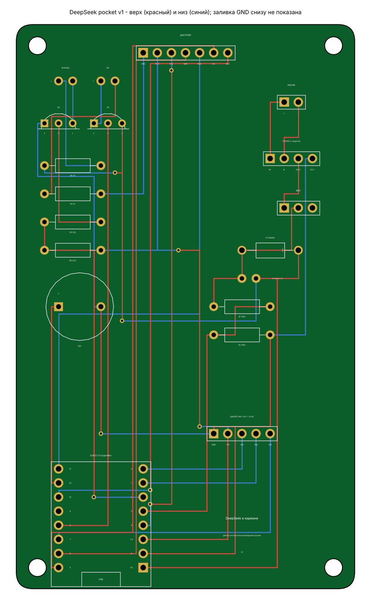

# Плата-основа (KiCad)

> **Черновик, будет переделан.** Плата сделана до SD-карты и до модуля зарядки с USB-C и повышением до 5 В. Сейчас в гаджете стоят они, а пищалка, ИК и фонарик сняты: их выводы GPIO2, GPIO8 и GPIO20 заняты картой (подключение — в главном [README](../README.md#sd-карта)). Новая плата будет сделана по замерам настоящих модулей. В неё войдут гнездо microSD, конденсатор 100 мкФ у карты и подтяжки GPIO2 и GPIO9 к 3V3. Не заказывайте эту версию.

Двусторонняя плата 61 × 102 мм. На неё впаиваются готовые модули: ESP32-C3 Super Mini, экран, джойстик, зарядка TP4056. На самой плате стоят питание с выключателем, делитель для процентов заряда, пищалка, ИК-светодиод для «Пульта» и фонарик. Все подключения совпадают с прошивкой, менять в ней ничего не нужно.

На картинке красным показаны дорожки сверху, синим снизу. Нижняя сторона дополнительно заливается землёй (GND), на картинке заливки нет.

## Файлы

- `deepseek-pocket.kicad_pro`, `deepseek-pocket.kicad_pcb` — проект для KiCad 8 или новее.
- `gen_pcb.py` — скрипт, который создал плату: размещение, трассировку и проверку зазоров. Изменили размещение — запустите `python3 gen_pcb.py`, и плата пересоберётся.
- Отдельной принципиальной схемы нет, соединения перечислены ниже.

## Соединения

| Что | Куда |
|---|---|
| Экран J1: GND, VCC, SCL, SDA, RES, DC, BLK | GND, 3V3, GPIO4, GPIO6, GPIO21, GPIO5, GPIO10 |
| Джойстик J2: GND, +5V, VRx, VRy, SW | GND, **3V3**, GPIO0, GPIO1, GPIO7 |
| Аккумулятор J3 (+, −) | B+, B− модуля TP4056 (J4) |
| TP4056 J4: OUT+ | выключатель SW1 → диод D1 → вывод 5V модуля |
| TP4056 J4: OUT− | GND |
| Делитель R1, R2 (100k + 100k) | после выключателя → GPIO3 → GND |
| Пищалка BZ1 | «+» на GPIO20, «−» на GND |
| ИК: Q1 S9014 | база — GPIO8, коллектор — 5V, эмиттер → ИК-светодиод D2 → R3 47 Ом → GND |
| Фонарик: Q2 S9014 | GPIO2 → R4 22k → база; R6 4,7k с GPIO2 на 3V3; 5V → R5 47 Ом → светодиод D3 → коллектор; эмиттер — GND |

## Что купить

| Обозначение | Деталь | Шт. |
|---|---|---|
| U1 | ESP32-C3 Super Mini + 2 гребёнки по 8 штырей | 1 |
| J1 | экран ST7789 240×240 1,3" (7 выводов, без CS) + гнездо 1×7 | 1 |
| J2 | джойстик KY-023 + провода или гнездо 1×5 | 1 |
| J4 | модуль TP4056 **с защитой** (6 площадок: B+ B− OUT+ OUT−) | 1 |
| J3 | аккумулятор LiPo 3,7 В (например, 500–1000 мА·ч) | 1 |
| SW1 | движковый выключатель (SS12D00 или любой, на проводах) | 1 |
| D1 | диод Шоттки 1N5819 | 1 |
| R1, R2 | резистор 100 кОм 0,25 Вт | 2 |
| R3, R5 | резистор 47 Ом 0,25 Вт | 2 |
| R4 | резистор 22 кОм | 1 |
| R6 | резистор 4,7 кОм | 1 |
| Q1, Q2 | транзистор S9014 (NPN, TO-92) | 2 |
| D2 | ИК-светодиод 5 мм, 940 нм | 1 |
| D3 | белый светодиод 5 мм | 1 |
| BZ1 | пищалка 12 мм, шаг выводов 7,6 мм (пассивная; для активной в скетче `BUZZER_ACTIVE = true`) | 1 |
| — | стойки и винты M3 | 4 |

## Перед заказом — обязательно

Плату я делал без KiCad, скриптом. Скрипт сам проверяет зазоры и что все сети соединены (0 ошибок), но окончательную проверку делает KiCad:

1. Откройте `deepseek-pocket.kicad_pro` в KiCad 8 или новее, затем «Редактор печатных плат».
2. Нажмите **B**: KiCad зальёт землю на нижней стороне.
3. **Инспектор → Проверка правил проектирования (DRC) → Запустить**. Ошибок быть не должно. Предупреждения о подписях и шелкографии не страшны.
4. **Проверьте модули по размерам.** Это самое важное: расстояние между рядами Super Mini (15,24 мм) и порядок его выводов взяты из типовой распиновки. Распечатайте плату 1:1 (**Файл → Печать**, масштаб 1:1, слои F.Cu и F.SilkS), положите модули на бумагу и сверьте: подписи 5V, G, 3.3, 4… на плате должны совпасть с подписями на вашем модуле. То же для экрана и TP4056.

## Заказ

1. В KiCad: **Файл → Выходные файлы для производства → Gerber**. Включите слои F.Cu, B.Cu, F.Mask, B.Mask, F.SilkS, B.SilkS, Edge.Cuts и нажмите «Создать файлы сверловки» (Excellon). Все файлы упакуйте в один ZIP.
2. Загрузите ZIP на сайт производителя печатных плат (JLCPCB, PCBWay, в России — например, Резонит). Сайт сам покажет плату.
3. Параметры: 2 слоя, 1,6 мм, любой цвет маски. Минимальные зазоры и дорожки на плате 0,2 мм и шире, отверстия от 0,4 мм — подходит самый дешёвый вариант.

## Сборка

- **Super Mini** впаивайте на штыревые гребёнки, а не вплотную: под модулем проходят дорожки и переходные отверстия. USB-разъём смотрит к нижнему краю.
- **Экран** ставится на высокое гнездо 1×7 (около 11 мм): под ним стоят резисторы и диод.
- **Светодиоды** D2 и D3 стоят у верхнего края: выведите их ножки так, чтобы светодиоды смотрели наружу. Длинная ножка (+) вставляется в отверстие с плюсом.
- **Транзисторы** ставятся плоской стороной к подписям E B C.
- **D1 или JP1 — только одно из двух.** Диод D1 защищает аккумулятор, когда гаджет подключён к компьютеру по USB модуля. Перемычка JP1 (кусок провода) вместо диода даёт на 0,3 В больше напряжения, но тогда **нельзя** подключать USB Super Mini при включённом выключателе.
- **Заряжать** через разъём модуля TP4056.
